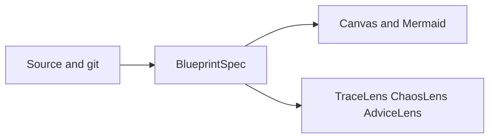

# Architecture concepts

ArchLens stores architecture as BlueprintSpec YAML and treats diagrams as a view of that file. C4 names the zoom levels. The scanner reads source text. ChaosLens explores failures on the model.

## C4 levels

| Level     | BlueprintSpec role                                | `entityRef` shape                   |
| --------- | ------------------------------------------------- | ----------------------------------- |
| Context   | Landscape: systems, people, external parties      | one segment, `acme`                 |
| Container | Deployable or bounded system inside the landscape | two segments, `acme/checkout`       |
| Component | Part inside a container                           | three segments, `acme/checkout/api` |
| Code      | Optional finer module                             | four segments                       |

Display names can change. `entityRef` is the identity other files, TraceLens signals, and ChaosLens faults attach to. A child diagram uses the same `entityRef` as the parent node you drill into.

## Model and picture

BlueprintSpec is the model. Mermaid and Canvas are pictures of it. Imports merge into the YAML. An export-only picture isn't a second source of truth, because two editable copies drift apart.

That choice makes pull-request review possible: the diff is YAML, and identity survives a rename of the label. A diagram tool outside BlueprintSpec can't round-trip layout and relationships on its own.

## Static structure and runtime behaviour

The scan is static. It reads abstract syntax trees, project files, and git history. It doesn't call the running system, sample traffic, or observe production.

Static analysis can see imports, project references, and declared infrastructure. It can't see a URL assembled at runtime, a queue name loaded from a secret, or traffic that never appears in source. Declared context exists so people and external parties outside the scan still sit on the landscape. Scan then fills systems onto that seed.

ChaosLens runs failure scenarios against the BlueprintSpec graph. The heatmap is a property of the model, not a measurement from production. TraceLens is historical git and complexity on the same nodes. AdviceLens ranks those two signals. None of the three replaces an observability system.

## Why the levels stay shallow

Four segments are enough for a map a team can review. Deeper trees turn the diagram into a file browser. Code-level nodes stay optional. When a monorepo needs fewer boxes, system roots and module rollup belong in config, described in [Configure monorepo boundaries](/how-to/monorepo-boundaries).
