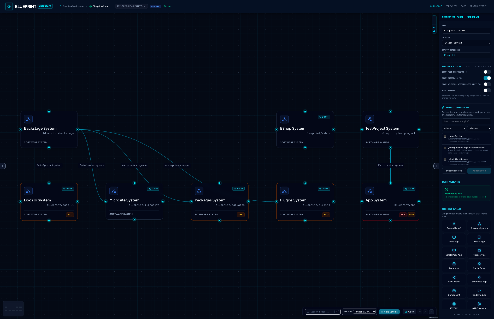
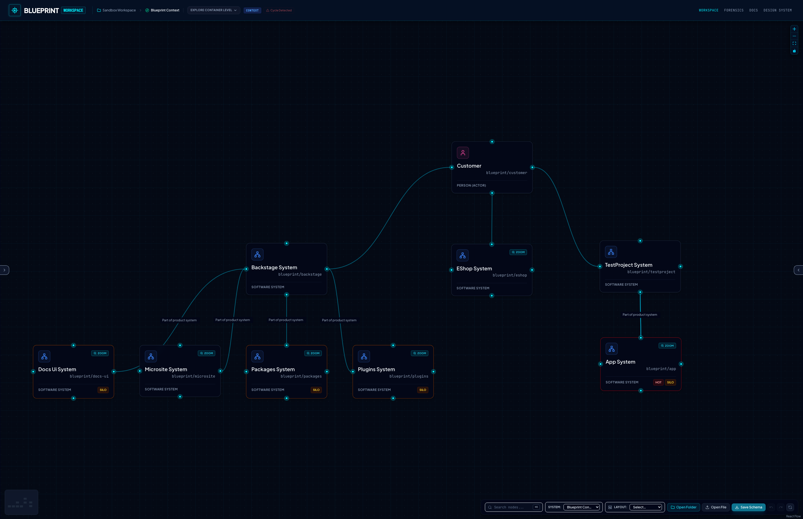
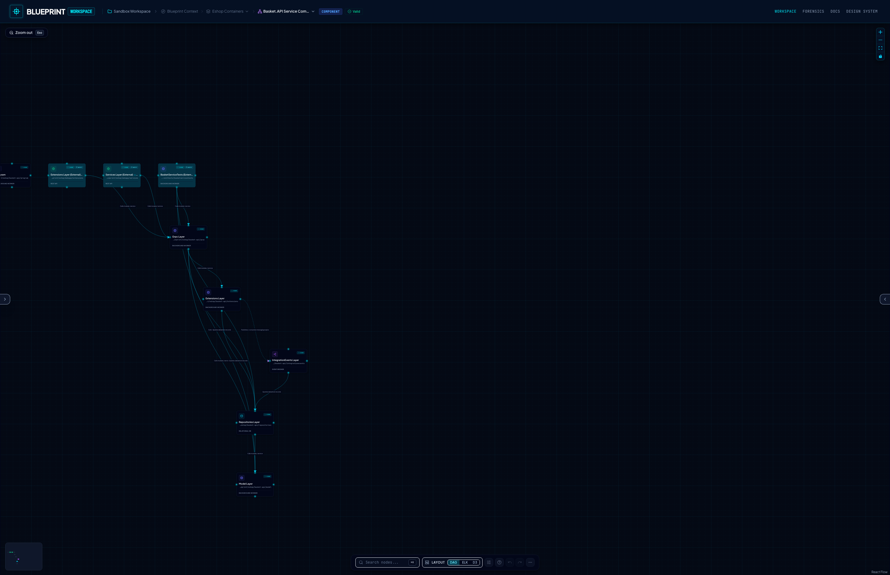
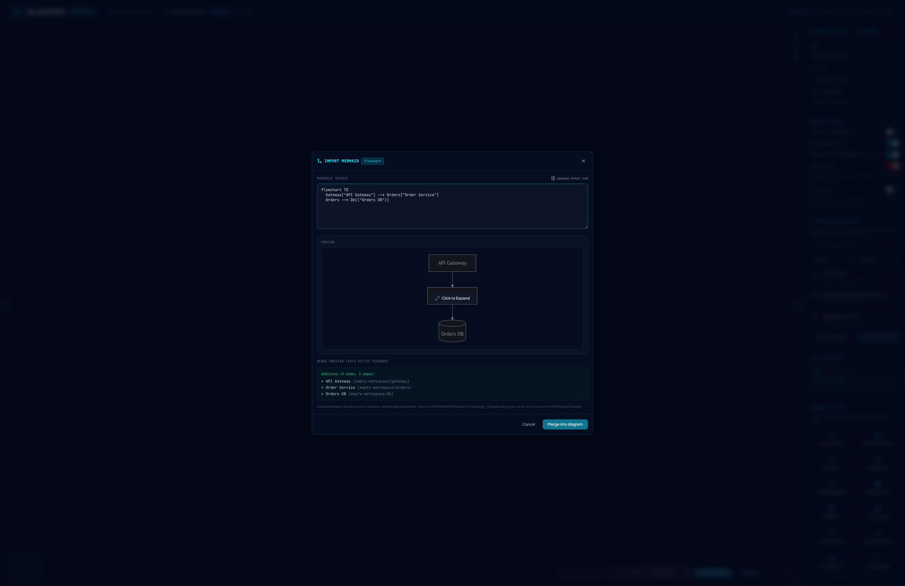
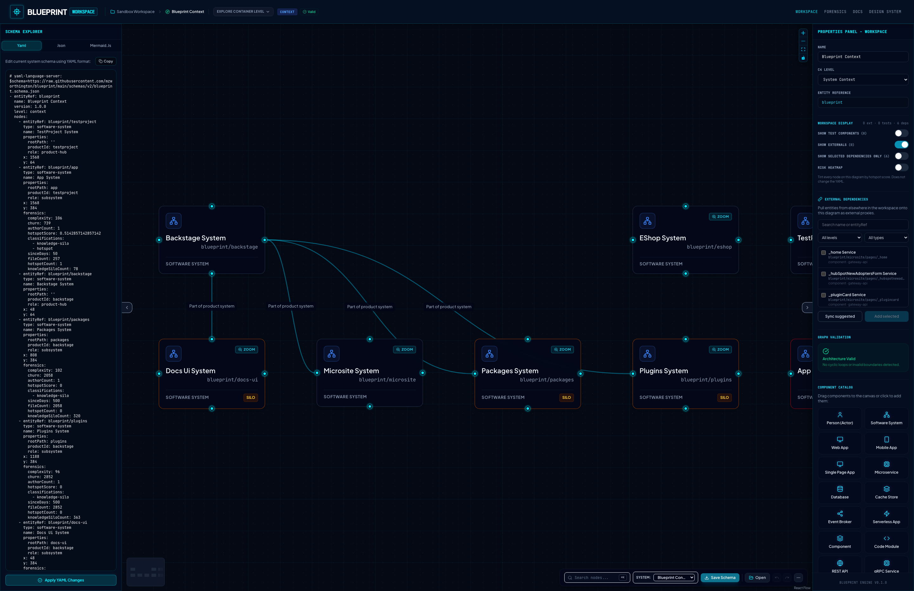

# ArchLens Canvas

ArchLens Canvas is the map over **BlueprintSpec**. You author it in a local folder, or you browse a catalog your pipeline published. Diagrams are views over a strict schema. Edit the diagram or the file, and the other side stays in sync.

## Opening a workspace

On bare `/workspace`, ArchLens shows a **startup chooser**. It doesn't open the demo on its own. Pick an intent, then a leaf action:

| Intent                  | What it does                                                                                                              |
| ----------------------- | ------------------------------------------------------------------------------------------------------------------------- |
| **Try the demo**        | Load the samples catalog and open **ChaosLens** on the golden journey, from blast radius to AdviceLens                    |
| **Full analysis (CLI)** | A collapsed strip under the demo: TraceLens git hotspots, watch mode, and CI catalog publish                              |
| **Investigate**         | Map real systems with a browser lite scan, a folder or a ZIP when the browser can't pick a folder, or a blueprints folder |
| **Collaborate**         | Share a live editing link, from a blank room or after you open a folder or file. See [Collaborate](./collaborate.md).     |
| **Ideate**              | Start a solo blank Canvas, or import Mermaid. Share later from the toolbar                                                |

A deep link under `/workspace/` skips the chooser and loads the demo so entity URLs resolve. If you open a folder or run a browser scan in this session, the demo doesn't replace that choice.

You can open a folder, run a browser lite scan, load a single YAML file, or import Mermaid from the toolbar **Open** menu. **Share live diagram** in the toolbar starts a room from a map you already have open, or it reopens that room.

## Live share

Peers join the same working copy: nodes, dependencies, identity, and layout. Named cursors and a connected-user count, including you, show who is in the room. **Require a secret** keeps the secret out of the URL. Folder **Commit** is still the only write to disk.

TraceLens overlays and ChaosLens heat stay in each browser. You can't undo during a live share. Access rules, expiry, and what a room isn't are in [Collaborate](./collaborate.md).

## Layout

- **Canvas** is the interactive diagram of systems, containers, and components.
- **Explorer**, on the left, has **TraceLens** and **Schema** tabs: forensics lenses, the dependency view, and YAML, JSON, or Mermaid for the active schema.
- **Properties**, on the right, holds identity, metadata, connections, the catalog, and validation.
- **Breadcrumbs** show where you are in the hierarchy.

On a desktop, the chevron rails at the panel edges expand or collapse Explorer and Properties. On a phone, the **Explorer** and **Props** chips in the toolbar open the left and right panels after you collapse both.

The bottom toolbar, the second row, has the layout engine controls, the **Lite** Canvas toggle, and **Resilience** for ChaosLens, with **Simulate** when a scenario is active.

Collapse the panels when you want the diagram alone:

## Selection and properties

Click a node to select it and open the right-hand **Properties** panel. Edit the name, the type, the properties, and the connection descriptions. External systems render with dashed borders.

The forensics metrics, the coupling lens, the dependency view, and the Canvas display toggles live in Explorer, on the **TraceLens** tab. See [TraceLens](./tracelens.md).

## C4 navigation

- A single click selects a node and opens **Properties**. It doesn't zoom into a child diagram.
- Double-click a node that has a child diagram, matched by `entityRef`, or use its **Zoom** button, to drill in.
- A node with no child diagram shows **Create zoom**. That adds an empty diagram one C4 level down, with `metadata.entityRef` equal to the node, and opens it. In an opened folder, ArchLens writes the new YAML beside the current file.
- Press `Esc`, or use the breadcrumbs or the zoom-out control, to go back up.

## Canvas and schema stay in sync

- Moving a node, wiring an edge, or editing a property updates the schema.
- Editing YAML or JSON in Explorer, on the **Schema** tab, redraws the Canvas.
- A workspace can load several systems from a `blueprints/` folder. Switch them with the Canvas system picker.

## Import Mermaid

Bring an external flowchart or C4 Mermaid diagram into the active schema. ArchLens parses it to `SystemSchema`, previews the merge, and applies only what you approve.

1. Open **Import Mermaid** from the toolbar **Open** menu. You need an active diagram.
2. Paste Mermaid, or upload a `.mmd` or `.md` file.
3. Review the preview, the additions, and any conflicts. Keep the existing node, rename the import, or overwrite.
4. **Merge into diagram** stays a draft until you commit through **Pending Draft Changes**. The Eclipse Layout Kernel runs after a successful merge.

Import drops forensics, rich properties, and styling from Mermaid. Don't edit the Code Viewer Mermaid tab and expect a round trip.

## Infrastructure from a scan

Terraform and Pulumi land through **Browser lite scan** or the CLI, using the same `IacAnalyzer` and **meaningful external** projection. There is no paste wizard. See [Meaningful external dependencies](./cli.md#meaningful-external-dependencies).

## External dependencies

Pull entities that already exist elsewhere in the loaded workspace onto the current diagram as external proxies, with dashed borders. Search by name or `entityRef`, filter by C4 level or type, then choose **Add selected** or **Sync suggested**.

Wire dependencies to those proxies as usual. At container level, the CLI and Canvas can roll component-level externals up into edges between containers.

After a CLI scan, ArchLens places cross-container dependency endpoints on component diagrams. A shared library import becomes a component-level edge, and that edge shows up as an external proxy on the child diagram. A container node shows an `Externals (N)` badge when its child diagram includes external dependencies.

## Search

Press `Cmd+K` on macOS, or `Ctrl+K` on Windows and Linux, to open the search bar in the top-right toolbar. Type to filter components and systems on the active diagram. Use the arrow keys to move, and press **Enter** to select that node on the Canvas. Search omits tests and externals that workspace display has hidden.

## Layout engines

Canvas recalculates layout with three engines:

- **Dagre**, the default, draws a layered directed graph.
- **Eclipse Layout Kernel (ELK)** draws complex diagrams.
- **d3-hierarchy** draws trees, which suits a pure nested hierarchy.

Choose a layout from the selector in the top toolbar. The choice recalculates positions and writes the new coordinates into the YAML.

## Component catalog

If you haven't selected a node, or if you expand the properties panel, you can place new nodes.

Click an archetype in the **Component Catalog**, for example Actor, Person, Web App, Database, Cache Store, Event Broker, Event, or a gRPC service, to place it on the Canvas. Wire it with the node's connection handles, and fill in its fields in the properties panel.

## Draft changes

As you edit systems and drag nodes, Canvas keeps the draft on this machine.

- In the bundled sandbox, IndexedDB tracks edits until you reload through **Try the demo** or discard them. Set `VITE_REMOTE_CATALOG_BASE_URL` when the sandbox YAML should come from the hosted catalog rather than the files embedded at build time.
- In an opened folder, IndexedDB tracks drafts against the on-disk baseline. **Commit** writes YAML back to the folder through the File System Access API.
- Click **Pending Draft Changes** in the top header to see a Git-style diff of added, modified, and deleted nodes and dependencies.
- **Revert** restores the baseline. **Commit** persists the draft, and only a folder workspace can commit.

## Validation and cycles

The top header checks the workspace as you edit.

- **Valid** means the schema matches the syntactic rules.
- **Cycle Detected** means the graph has a circular dependency. The loop path animates and highlights in red so you can break it.

## Workspace display

Canvas visibility and TraceLens overlays are in Explorer, on the **TraceLens** tab, under **Workspace display**:

| Toggle                              | Effect                                                                       |
| ----------------------------------- | ---------------------------------------------------------------------------- |
| **Show Test Components**            | Reveal nodes marked `isTest`. They're hidden by default.                     |
| **Show Externals**                  | Show or hide external proxy nodes in the upstream and downstream bands.      |
| **Show Selected Dependencies Only** | After you select a node, show only its upstream and downstream dependencies. |
| **Risk Heatmap**                    | Tint nodes by `hotspotScore`. See [TraceLens](./tracelens.md).               |
| **Coupling Lens**                   | Focus coupled peers on the Canvas. See [TraceLens](./tracelens.md).          |

**Lite** on the bottom toolbar speeds up pan and zoom on a large diagram. It hides the minimap and the grid, simplifies nodes, and caps edge animation.

A dependency edge draws an arrow toward the target, from `from` to `to`. Selecting a node animates the edges connected to it. With focus mode on, that's every visible edge. Lite Canvas limits the animation to the selection's neighborhood. `prefers-reduced-motion` turns off the edge dash animation.

A summary line in **Workspace display** shows live counts as `callers · targets · tests · deps` for the whole diagram or for the selected node.

## ChaosLens

Model a what-if failure on the diagram you already have open. It uses the same Canvas, and it has no separate route.

1. Click **Resilience**, the shield icon, in the bottom toolbar to open **ChaosLens**. The header badge becomes `CHAOSLENS`, and the right panel switches to fault controls and telemetry.
2. Select a node, then set the fault type, the severity, and the safeguards: circuit breaker, bulkhead, retry, and local cache.
3. Click **Simulate**. The Canvas shows a blast-radius heatmap, tinted red by impact. The panel shows SLA bands, SLO bands, each SPOF, and the advice.

Simulate leaves the YAML unchanged. The TraceLens **Risk heatmap** stays off while ChaosLens is active. See [ChaosLens](./chaoslens.md) for propagation rules and limits.

## Offline

ArchLens Canvas installs as a Progressive Web App (PWA). After the first visit, the app shell can load offline, so you can keep editing a local workspace. An offline banner appears when the network drops. After a newer build ships, an update banner at the top offers **Refresh**, which loads the hashed assets and service worker from that build. A visible tab looks for that deploy right away, and again about once a minute, so you can stay on the tab. Offline editing doesn't need the docs screenshots or the public schema URLs.

## Next

- [Collaborate](./collaborate.md) covers share, rooms, and comments.
- [ArchLens CLI](./cli.md) covers how diagrams get generated.
- [Design system](/design-system) covers visual assets and the identity sandbox.
- [Interface tour and journeys](../journeys.md) walks through the product end to end.
