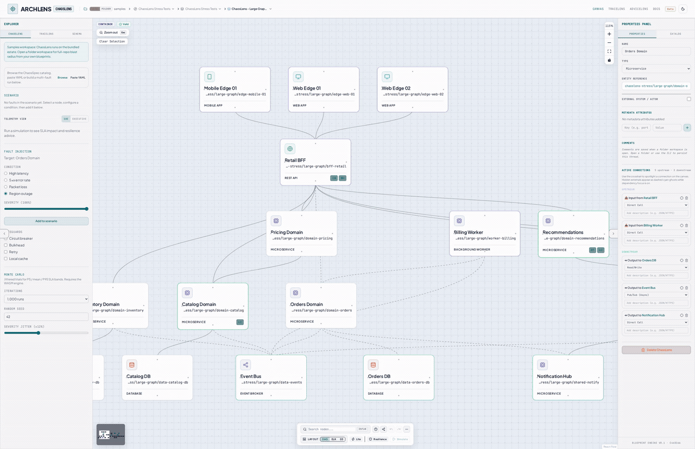

# ChaosLens

**ChaosLens** simulates what-if failures on the architecture you already have open in ArchLens Canvas. It runs on the workspace Canvas against the active diagram. There is no separate diagram and no separate route.



The bands are a simplified model. They're not a production service level objective.

## Turn it on

1. Open `/workspace` and load a diagram from the sandbox, a folder, or a deep link.
2. In the bottom toolbar, click **Resilience** to open ChaosLens.
3. The header badge switches to `CHAOSLENS`. The right panel shows fault controls and telemetry instead of property editing.

Click **Resilience** again to leave ChaosLens. That clears the simulation and the safeguard toggles.

## Run a simulation

1. Select a node on the Canvas. A single click selects it. Use **Zoom**, or double-click, to open a child diagram.
2. In the right panel, choose the fault, the severity, and the safeguards.
   - **Fault type.** High latency, 5xx error rate, packet loss, or region outage.
   - **Severity.** A slider from 0 to 100%.
   - **Safeguards.** Circuit breaker, bulkhead, retry, and local cache. These are session toggles on the selected node.
3. Click **Simulate** in the bottom toolbar.

Simulate opens the right panel when you had closed it. Run the simulation again after you change the fault or the safeguards.

When the Monte Carlo engine is available, telemetry also shows P5, mean, and P95 service level agreement bands from jittered trials, typically 1,000 runs. Without WebAssembly, the TypeScript fallback runs the same propagation rules, including group boundaries, and reports a single overall service level agreement.

With a workspace loaded, **Simulate** also builds a simulation closure. The closure adds missing external neighbors, keeps upstream callers in scope, and pulls in edges from an external proxy's home diagram so blast radius can cross diagram boundaries. One example is Auth Session DB, then Auth, then Storefront API.

## What the simulation models

Dependencies use the usual BlueprintSpec direction. `{ from: 'web', to: 'api' }` means **Web calls API**.

Failures propagate upstream to callers, the nodes that depend on the faulted node. They don't propagate downstream to dependencies. That track is availability: red heat and the service level agreement.

Publish-subscribe edges also drive a separate data-integrity track, shown as amber heat. When a publisher faults, the broker and peer subscribers on the same topic show staleness, and the entry-point service level agreement can stay intact. When the broker faults, both availability and integrity degrade for every attached client.

| Step              | What happens                                                                                |
| ----------------- | ------------------------------------------------------------------------------------------- |
| Origin            | The faulted node gets the base severity. Region outage is about 100%. Latency is about 40%. |
| Propagation       | Each hop upstream multiplies severity by `0.75`.                                            |
| Circuit breaker   | Stops propagation above that node. The node still shows local impact.                       |
| Local cache       | Halves incoming severity on that caller.                                                    |
| Retry             | Multiplies severity by `1.2`. Retries make cascades worse.                                  |
| Bulkhead          | Caps propagation at 2 hops past that node.                                                  |
| Pub-sub integrity | A publisher fault marks the broker and peer subscribers at half severity.                   |

Entry points are nodes that nothing else depends on, the top of the call chain. Each entry point's service level agreement is `(1 − availability heat) × 100%`. The overall figure is the average across entry points. Overall integrity is separate. It's the average correctness across nodes with an integrity impact.

A single point of failure is a dependency with two or more callers and no circuit breaker recorded on the node. See the schema section below.

## On the Canvas

After a simulation:

- Nodes tint red by availability blast heat. They tint amber when integrity drops and availability doesn't. The YAML stays unchanged.
- The fault target gets an orange border.
- Single points of failure get an amber label.
- ChaosLens hides the TraceLens risk heatmap for the duration of the simulation.

Heat is transient Canvas styling, the same pattern as the TraceLens hotspot overlay.

## Right panel telemetry

| Section                  | Meaning                                                                                                                   |
| ------------------------ | ------------------------------------------------------------------------------------------------------------------------- |
| Telemetry view           | `SRE` shows entity refs, Monte Carlo, and single points of failure. **Executive** is a plain-language continuity summary. |
| Service level agreement  | Overall and per-entry-point availability after the fault, on the `SRE` view.                                              |
| Data integrity           | Correctness and staleness on async streams. This is independent of availability.                                          |
| Monte Carlo              | When the engine is available, mean, P5, and P95 across jittered trials.                                                   |
| Single points of failure | Shared dependencies that lack a circuit breaker. This is structural, not specific to the fault.                           |
| Impacted domains         | The parent diagram, or the top-level ref prefix, for impacted nodes on the availability track.                            |
| Resilience advice        | Rule-generated suggestions for single points of failure, blast radius, and integrity.                                     |

## Save safeguards in YAML

ChaosLens writes safeguard toggles to the active diagram draft as top-level `resilience` on the node, next to `forensics`. They appear in Explorer, then **Schema**, as YAML or JSON, and in **Pending Draft Changes** before you commit.

You can also author them by hand.

```yaml
nodes:
  - entityRef: shop/api
    name: API Gateway
    type: gateway-api
    resilience:
      circuitBreaker: true
```

The simulation reads `node.resilience` when no UI override exists for that node.

## ChaosSpec scenarios

Version-controlled failure scenarios live in `chaos-specs/` as YAML. Each file points at a blueprint diagram with `metadata.diagramRef`. It doesn't copy the topology. Browse the catalog from **Open, then Browse ChaosSpecs**, or from ChaosLens **Browse**. That opens the target diagram and loads the scenario. Paste, upload, and export stay under **Load ChaosSpec** and **Export ChaosSpec**.

The contract, public schema URLs, and field reference are in [ChaosSpec](./chaos-spec.md).

## Limits

- Multi-fault scenarios come from the scenario list, the **Browse ChaosSpecs** catalog, or a paste or upload.
- Load and export ChaosSpec from the shared **ChaosSpec** dialog. Import and Export are separate tabs. The catalog picker navigates by `diagramRef`.
- WebAssembly Monte Carlo runs when you deploy the resilience engine. The TypeScript fallback uses the same propagation rules and omits the trial bands.
- The headless estate sweep and the CI service-level gate ship through [AdviceLens](./advicelens.md), with `archlens resilience` and `.github/actions/advicelens-gate`. There is no separate ChaosLens binary.
- There is no OpenTelemetry import.
- The service level agreement numbers are a heuristic. They don't model queues, timeouts, or pools.
- The executive view omits revenue and user-journey mapping.

## Next

- [AdviceLens](./advicelens.md) for ranked recommendations from simulation and forensics
- [ArchLens Canvas](./canvas.md) for panels, display toggles, and navigation
- [TraceLens](./tracelens.md) for the hotspot heatmap, which stays hidden during ChaosLens
- [ChaosSpec](./chaos-spec.md) for the scenario contract and public schema URLs
- [BlueprintSpec](./schema.md) for `dependencies` and `entityRef` rules
- [ChaosLens engine](../chaoslens-engine.md) for the Go and WebAssembly engine, the local build, and the core API
