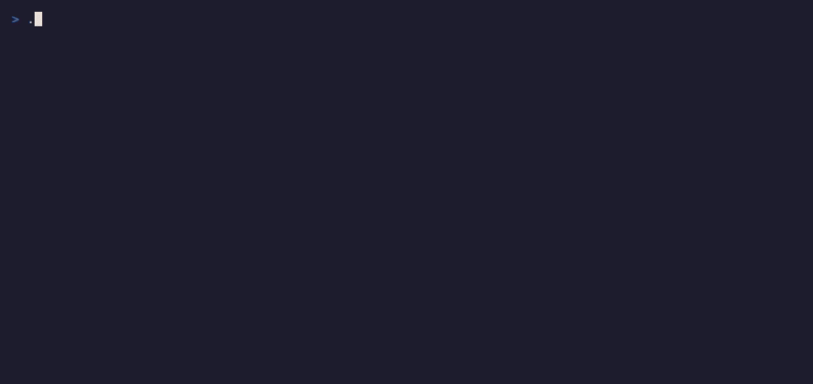

# ArchLens CLI

**ArchLens CLI** scans source, discovers systems and dependencies, lays them out with Dagre, and writes BlueprintSpec.



## Install

On macOS and Linux:

```bash
curl -fsSL https://raw.githubusercontent.com/mzworthington/archlens/main/scripts/install.sh | bash
```

On Windows: `irm https://raw.githubusercontent.com/mzworthington/archlens/main/scripts/install.ps1 | iex`

Then run `archlens --version`. Options, manual downloads, and the path from scan to Canvas are in [Getting started](./getting-started.md).

## Modes

1. **Interactive.** A bare `archlens` opens a menu: scan wizard, publish snapshot, publish fragment, compose estate, and accept or reject overlays.
2. **Quick scan.** `archlens scan`, or `archlens --scan`, runs headless. Defaults come from `blueprint.config.json` or the environment, and the command doesn't prompt.
3. **Enrich existing YAML.** `archlens enrich` re-runs the externals pass on blueprint files already on disk. It doesn't scan source again.
4. **Validate architecture health.** `archlens validate [path]` reports module cycles and forensics fix actions. Coupling stays informational. Optional `--since-commit` checks a regression, and `--contract` checks wiring.
5. **Diff blueprint trees.** `archlens diff <baseline> <current>` compares structure for a pull-request gate.
6. **AdviceLens estate sweep.** `archlens resilience [path]` runs ChaosLens scenarios and ranks recommendations.
7. **Flags or a non-TTY session.** Either suits automation.

```bash
archlens
archlens scan
archlens enrich
archlens enrich --output=custom-blueprints
archlens validate blueprints/
archlens diff base-blueprints/ pr-blueprints/
archlens resilience blueprints/ --format=json --output=.archlens/advicelens-report.json --min-sla=95
archlens catalog publish-fragment blueprints/ --estate=acme --product=payments --source-ref=repo@sha --no-dry-run
archlens catalog compose --estate=acme --no-dry-run
archlens --headless --glob="**/*.{ts,tsx}" --output="blueprints"
```

See [GitHub Actions workflows](./ci-workflows.md) for the publish, fragment, and compose jobs.

## Remote catalog

Publishing doesn't change BlueprintSpec. Multi-pipeline publishing stages fragments and optional suggestion overlays, then composes them into an ADR-0010 `latest` snapshot. See [ADR-0014](../ADRs/0014-estate-fragments-and-compose-before-publish.md).

| Command                                             | Purpose                                                           |
| --------------------------------------------------- | ----------------------------------------------------------------- |
| `archlens publish [path]`                           | Whole-tree snapshot upload, one complete tree                     |
| `archlens catalog publish-fragment [path]`          | Stage a product or slice under `fragments/`                       |
| `archlens catalog compose --estate=<id>`            | Stitch fragments and overlays into `snapshots/` and CAS `latest/` |
| `archlens catalog accept-overlay --file=<yaml>`     | Stage an accepted suggestion overlay                              |
| `archlens catalog reject-overlay --overlay-id=<id>` | Tombstone an overlay                                              |

Publish and compose prefer a visible upload over a blocked one. Validation doesn't block the upload by default. Use `archlens validate` or `--validate` when you want a hard gate. `--skip-validation` is always allowed.

Object storage uses `OBJECT_STORAGE_*` or R2 credentials. See [Cloudflare secrets](../cloudflare-secrets.md). The samples estate key prefix is `estates/samples/`, a shared estate whose products include `samples`, `archlens`, and the demo ids.

## Flags

Types, defaults, and exit codes are in the [CLI reference](../reference/cli.md).

With the default `tree-sitter` parser, language coverage includes TypeScript, JavaScript, C#, Python, Go, and Java. WASM grammars ship with the release binary. The default glob is `**/*.{ts,tsx,cs,java,go,py,tf}`. Pass `--parser=ts-morph` for a TypeScript-only tree.

The scan detects Terraform files, `.tf` and `.tf.json`, and Pulumi projects, `Pulumi.yaml`, under the scan root. Separate IaC passes map them when they find a root module or project. You don't pass an extra flag. The default glob includes `*.tf`, so those paths stay in scope. AST parsers skip them.

The analyzer layout for contributors is in the [CLI README](https://github.com/mzworthington/archlens/blob/main/app/packages/cli/README.md).

## Declare then scan

By default, a scan creates a system context when none exists: the discovered systems, plus a fallback `User` actor. You can instead declare a sparse context BlueprintSpec so the scan extends that landscape. See [ADR-0015](../ADRs/0015-declared-context-hydration.md) and the shape in [Declared system context](./schema.md#declared-system-context).

### Workflow

1. Author, or assemble, a `level: context` seed under the output directory:
   - `blueprints/<ctx>/context.yaml`, or
   - `blueprints/context.yaml` when you omit the context folder.
     Prefer an existing seed path when you run the scan again.
2. Run the scan with the same `--context`, and the same `--output`, so the writer loads that file as the merge base.
3. Open the result in Canvas. Personas and third parties stay. The scan hydrates systems from the repo.

```bash
# Example: seed already at blueprints/acme/context.yaml
archlens scan --headless --output=blueprints --context=acme
```

### What a scan does to a declared seed

| Situation                                         | Result                                                                                               |
| ------------------------------------------------- | ---------------------------------------------------------------------------------------------------- |
| Seed missing                                      | Create the context, the systems, and a fallback `User`. This is the default path.                    |
| Seed present                                      | Upsert discovered systems onto matching `entityRef`s. Keep personas, third parties, and their edges. |
| One or more product personas                      | Don't inject the fallback `User`.                                                                    |
| A system disappeared from this scan's `rootPath`s | Prune that scan-owned orphan only. Systems from other repos stay.                                    |
| Unreadable seed                                   | Warn, then create a fresh context.                                                                   |

**Display names.** Omit `name` on a declared node to derive a label from the `entityRef` leaf. An author-owned label wins over a scan default. Estate compose prefers a curated name over a derived one.

### Multi-repo products

Scan each repo with the same `--context` and a distinct `--system-name`, or `systemName` in config. Share stable system `entityRef`s in the declared seed so every repo hydrates the same anchors. Personas and third parties union by `entityRef` when fragments compose. See [ADR-0014](../ADRs/0014-estate-fragments-and-compose-before-publish.md).

You don't need a home-versus-secondary seed flag. Omit a redundant `name`, and keep one shared identity per entity.

### Infrastructure packages and repos

When Terraform or Pulumi lives in a separate package or repo, declare an infra spoke in the shared context seed and list the product systems it supports:

```yaml
# blueprints/acme/context.yaml (shared landscape seed)
nodes:
  - entityRef: acme/checkout
    type: software-system
  - entityRef: acme/cloudflare
    type: software-system
    name: Cloudflare Hosting
    properties:
      role: infrastructure
      serves: acme/checkout # comma-separated for several products
```

Then scan the infra root with the same `--context`, and with a seed already present under `--output`:

```bash
# Explicit infra package / repo - cwd is the Pulumi/Terraform project
cd infra/cloudflare
archlens scan --headless --output=/path/to/blueprints --context=acme
```

The scan attaches container products under that spoke and proposes vendor third parties, with an edge from each `serves` target. See [Meaningful external dependencies](#meaningful-external-dependencies).

### This repository

ArchLens commits its own seed at [`blueprints/archlens/context.yaml`](https://github.com/mzworthington/archlens/blob/main/blueprints/archlens/context.yaml), the same path a consumer uses. A publish scan hydrates into that file. There is no separate JSON assemble step.

An external demo repo has no in-tree seed, so [publish-demo-catalog](./ci-workflows.md) assembles a synthetic context from `contextDeclaration` on each entry in [`scripts/blueprint-sample-repos.json`](https://github.com/mzworthington/archlens/blob/main/scripts/blueprint-sample-repos.json), through `scripts/assemble-context-seed.mjs`, before the scan.

## Deliverable

The deliverable is YAML under the output directory, not a separate TraceLens report. The architecture graph is the product. Git signals attach onto `node.forensics` when you enable them.

### Dependency resolution

The analyzer links containers and components from:

- Relative imports inside the scanned tree.
- Workspace `package.json` names in a monorepo, such as `/core` to `packages/core`, including a subpath import.
- `.csproj` project references and C# `using` resolution. See [C# and .NET analysis](../../README.md#c-and-net-analysis).

The match skips Node.js built-in modules. Run `archlens enrich` to re-apply the externals pass on existing YAML without a full source scan. That adds a missing cross-diagram edge and an external proxy node after a CLI or core upgrade.

### Terraform

When the scan root contains Terraform, `.tf` or `.tf.json`, the CLI also writes infrastructure diagrams.

- It discovers root modules, directories with `.tf` files. A nested module directory isn't a separate system.
- It parses the files statically. It doesn't run `terraform init` or `terraform plan`.
- It adds an **Infrastructure** hub on `context.yaml` and links each Terraform root as a spoke, the same pattern as a code product hub.
- It writes `blueprints/<root>/containers.yaml` for each root module.
- Context diagrams use **d3-hierarchy**, from person to hubs to subsystems. Container and component levels keep Dagre.

You don't pass a flag. If Terraform files exist under the scan root, the scan maps them.

### Pulumi

When the scan root contains Pulumi projects, `Pulumi.yaml`, the CLI also writes infrastructure diagrams.

- It discovers Pulumi projects, directories with `Pulumi.yaml`. It skips a nested project under an outer root.
- It parses the files statically. It doesn't run `pulumi preview` or a stack export.
- It adds an **Infrastructure** hub on `context.yaml` and links each project as a spoke, the same pattern as a Terraform root.
- It writes `blueprints/<project>/containers.yaml` for each project.
- It collects source files by runtime:
  - `yaml` collects `*.yaml` and `*.yml` in the project directory, and it skips stack config such as `Pulumi.prod.yaml`.
  - `nodejs` collects `*.ts` and `*.tsx` in the project directory.
  - The scan discovers `python`, `go`, and `dotnet` projects for diagram structure. Static parsing is strongest for YAML and TypeScript runtimes.

You don't pass a flag. If `Pulumi.yaml` exists under the scan root, the scan maps the projects.

## Meaningful external dependencies

An IaC stack is often noisy, and one Pulumi or Terraform project may mix many providers. ArchLens CLI treats Pulumi and Terraform as packaging, one infra spoke per project, and treats providers as the external vocabulary. A provider pack classifies each resource so the diagram stays useful.

**IaC versus infrastructure, [ADR-0016](../ADRs/0016-iac-declaration-vs-provisioned-infrastructure.md).** A primary resource becomes two linked nodes. Supporting and noise resources stay as IaC only.

| Node                     | Ownership                            | Flags                                               | Role                                                     |
| ------------------------ | ------------------------------------ | --------------------------------------------------- | -------------------------------------------------------- |
| **IaC declaration**      | Owned code, every classified address | internal, `iac.view: declaration`                   | The full code graph, including DNS, IAM, and CORS        |
| **Provisioned resource** | The cloud product, primaries only    | `external` plus `third-party`, `iac.view: resource` | The runtime and external summary                         |
| **Edge**                 | Primary declaration to resource      | type `provisions`                                   | Not a runtime call. ChaosLens skips it for blast radius. |

A supporting or noise declaration keeps `iac.significance`. It doesn't get a provisioned companion.

### What you get at each C4 level

| Level         | Grain                                                                                                                                                                          | Example from one stack                                         |
| ------------- | ------------------------------------------------------------------------------------------------------------------------------------------------------------------------------ | -------------------------------------------------------------- |
| **Context**   | One third party per vendor that had at least one primary product                                                                                                               | `vendor-cloudflare`, `vendor-aws`                              |
| **Container** | The full IaC declaration graph under the infra spoke. Only a primary product gets a provisioned companion and a `provisions` edge. Supporting and noise stay declaration-only. | A Pages project, plus Pages. A DNS record stays a declaration. |

An author-declared third party in the seed, for example a curated Cloudflare R2 catalog, survives hydration. The scan proposes vendors through ADR-0015. It doesn't replace your labels.

### Provider packs

| Pack           | Example primaries                                     | Typically filtered as supporting or noise                    |
| -------------- | ----------------------------------------------------- | ------------------------------------------------------------ |
| Cloudflare     | Pages, R2                                             | DNS records, Pages domains, CORS, zone data                  |
| AWS            | Lambda, S3, RDS, DynamoDB, messaging, edge, compute   | IAM roles and policies, security groups, bucket helpers      |
| Azure          | Functions, SQL, Redis, compute, storage, edge         | Role assignments, network security groups, private endpoints |
| `Google Cloud` | `Cloud Functions`, `Cloud SQL`, GCS, Pub/Sub, compute | IAM bindings, firewalls, data sources                        |

An unknown provider, for example Datadog, passes through unchanged until a pack exists.

### A stack with several providers

A project that provisions Cloudflare Pages and AWS Lambda plus S3 yields:

- **Containers** under the infra spoke: an IaC declaration for every classified resource, a provisioned product node for each primary, Pages, Lambda, and S3, and a `provisions` edge from each primary.
- **Context** third parties: Cloudflare and AWS, each with a dependency from the systems listed in `serves`.

IAM roles, DNS records, and bucket policies remain IaC declaration nodes. They aren't projected as third-party products.

### Infra membership

Declare `properties.role: infrastructure` and `properties.serves: <system-ref>[,…]` on the infra spoke in the seed. See [Declared system context](./schema.md#declared-system-context). When the Pulumi project is the scan root, a dedicated infra package or repo, the system id is the directory name, for example `cloudflare`, so a seed `entityRef` such as `acme/cloudflare` matches.

### Infra scan in this repository

ArchLens uses [`infra/cloudflare`](../../infra/cloudflare) with the committed seed [`blueprints/archlens/context.yaml`](../../blueprints/archlens/context.yaml). `archlens/cloudflare` serves `archlens`.

Canvas has no IaC paste wizard. Browser lite scan and the CLI share this significance filter. See [Infrastructure from a scan](./canvas.md#infrastructure-from-a-scan).

### Editor validation

Install the YAML extension. A generated file sets `version` to the public schema URL. You can also point the language server at `latest`:

```yaml
# yaml-language-server: $schema=https://archlens.dev/schemas/latest/blueprint.schema.json
```

Prefer the versioned URL, `/schemas/v4/…`, when you pin a contract. `/schemas/latest/…` tracks BlueprintSpec on `main`. Format and editor setup are in [BlueprintSpec](./schema.md). Wire-format details for contributors are in [Setup, YAML format](../setup.md#yaml-format-v4).

## Next

- [TraceLens](./tracelens.md)
- [BlueprintSpec](./schema.md), including [declared system context](./schema.md#declared-system-context)
- [ArchLens Canvas](./canvas.md)
- [GitHub Actions workflows](./ci-workflows.md)
