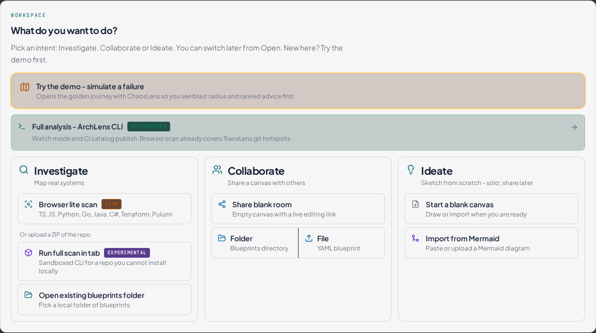
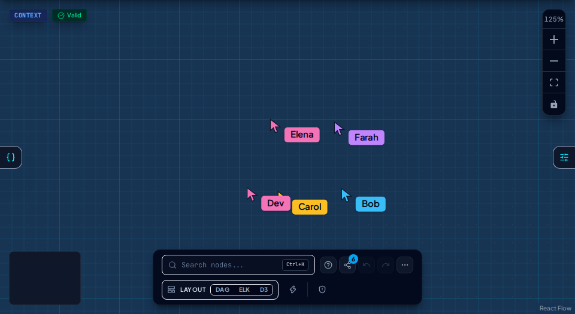

# Collaborate

Collaboration is a live **room** on the map. **Share** copies a link peers open in the browser. **Comments** stay on that session. Send this URL:

```
https://archlens.dev/guide/collaborate
```

No ArchLens account. Named cursors show who is looking where. Writing YAML back to disk still goes through **Pending Changes**.

Live share is an opt-in room, not a second source of truth. Folder workspaces stay local-first. Published catalogs stay a CI publish. See [Privacy](../privacy.md) for what a room actually sends.



## Why it's on the chooser

Architecture review usually dies as screenshots, an exported Portable Network Graphics (PNG) file, or a YAML file that diverges the moment someone edits it. **Collaborate** keeps the conversation on the live map: nodes, dependencies, `entityRef` identity, and layout.

Invite peers into the room for a walkthrough, a design session, or a review. Don't use it as a team wiki, a catalog, or a substitute for git.

## Start a room

On bare `/workspace`, pick **Collaborate**:

| Option               | What it does                                          |
| -------------------- | ----------------------------------------------------- |
| **Share blank room** | Empty Canvas plus a live editing link                 |
| **Folder**           | Open a blueprints directory, then create a share link |
| **File**             | Open a YAML blueprint, then create a share link       |

You can share later from any open diagram with the toolbar command **Share live diagram**. Ideate, whether a solo blank or an imported Mermaid file, stays solo until you share.

The share dialog asks for **Your name**, from 1 to 40 characters. That name is what others see on your cursor. **Copy link** puts a URL with `?room=` on the clipboard.

## Who can join

No ArchLens account. The host chooses access when copying the link:

| Who can join             | What guests need                                                                                       |
| ------------------------ | ------------------------------------------------------------------------------------------------------ |
| **Anyone with the link** | The URL. A forwarded link is enough to edit.                                                           |
| **Require a secret**     | The URL plus a secret of at least 8 characters. The secret isn't in the link. Tell people out of band. |

Peers open the link, enter a display name, and enter the secret if the host set one. The diagram stays hidden until that succeeds. A wrong secret doesn't reveal the map.

**End automatically** can keep the room until you end it, or close it in 8 hours or 24 hours. The host can also **End this session**.

The toolbar badge is a connected count that includes you. Open **Share live diagram** again. **In this session** lists names and colours. Peer pointers appear on your Canvas with those names. Your own pointer isn't drawn on your view.



## Comments

Comments belong to the live room. They aren't written into BlueprintSpec YAML, and they leave with the session.

Open **Properties** while the room is active:

- Click empty Canvas and clear the selection. The **Comments** thread is on the diagram, which is the map's `entityRef`.
- Select a node. The thread is on that entity.

| Control             | What it does                                                                       |
| ------------------- | ---------------------------------------------------------------------------------- |
| **Add comment**     | Posts the text. The body and your display name show up for peers without a reload. |
| **Resolve comment** | Drops it from the open thread. Only the author gets this control.                  |
| **Delete comment**  | Drops it from the open thread. Only the author gets this control.                  |

The thread stays hidden until a share session is active.

## What the room syncs

The room is a shared working copy of the workspace. That copy is every open diagram, with its nodes, dependencies, identity, and layout. Peers stay in that one room and switch diagrams from **Diagrams in this room**. An edit lands on the diagram you have open. A peer on another diagram keeps their own file. A link still works when you only have one of the files. The missing siblings aren't an error, and the file you do have still opens. Notes on the map are [comments](#comments).

These stay on each browser, not in the room:

- TraceLens overlays. That covers the risk heatmap and the coupling lens.
- ChaosLens blast-radius heat and telemetry
- IndexedDB drafts versus on-disk YAML, until someone commits via Pending Changes

**Undo** and **Redo** are unavailable while a share session is active. Local snapshot undo doesn't compose with live edits.

## What a room isn't

- Not a published catalog. Pipeline, then object storage, then Canvas, is still [CLI publish](./cli.md).
- Not disk. Folder **Commit** remains the only write back to YAML.
- Not Linear tickets or voice and video. A workspace share is one room for the diagrams you have open, not a second copy of the folder on disk.
- Not product sign-in. Treat an open link like a meeting URL.

On the hosted app, peers on other machines join through the collab Worker at `collab.archlens.dev`. Local builds without a collab WebSocket URL only share across tabs on the same machine.

## Join from a link

Deep links with `?room=` skip the startup chooser. Peers still enter a display name, and a secret when the host required one, before the diagram appears.

## Next

- [ArchLens Canvas](./canvas.md) - chooser, panels, drafts, and commit
- [Privacy](../privacy.md) - local drafts versus a live session
- [Jobs for today](./jobs.md)
