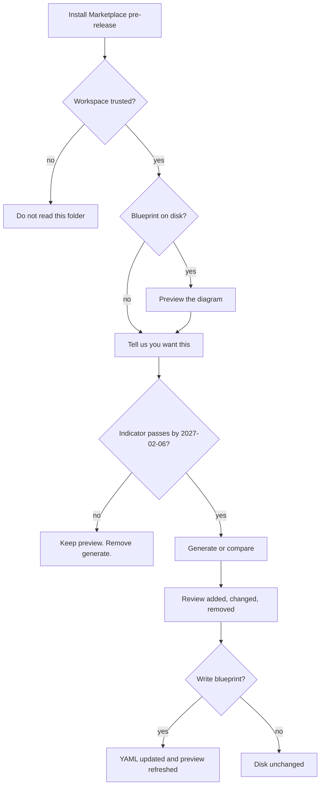

# PRD / bet: Editor extension on the Visual Studio Marketplace

## Metadata

| Field       | Value                                                                                                                                                                                                                                                                        |
| ----------- | ---------------------------------------------------------------------------------------------------------------------------------------------------------------------------------------------------------------------------------------------------------------------------- |
| **Project** | archlens                                                                                                                                                                                                                                                                     |
| **Kind**    | bet                                                                                                                                                                                                                                                                          |
| **Status**  | ready                                                                                                                                                                                                                                                                        |
| **Date**    | 2026-11-06                                                                                                                                                                                                                                                                   |
| **Owner**   | ArchLens maintainers                                                                                                                                                                                                                                                         |
| **Linear**  | [MZW-159](https://linear.app/mzworthington/issue/MZW-159/preview-and-generate-architecture-diagrams-in-the-editor). The open-map slice already exists as [MZW-152](https://linear.app/mzworthington/issue/MZW-152/open-this-folders-architecture-map-in-visual-studio-code). |

## Problem

Engineers who already have a repo open still leave the editor to see the architecture map. ArchLens Canvas draws BlueprintSpec in the browser. The CLI writes that YAML from source. Neither one is where the code change happens. A folder with no `blueprints/` tree has no map to open at all. [MZW-152](https://linear.app/mzworthington/issue/MZW-152/open-this-folders-architecture-map-in-visual-studio-code) covers reading a map that is already on disk. It does not cover install from the Marketplace or generating a map from the workspace.

We know this from the product shape, not from a usage metric. There is no editor extension in the field, so the baseline is unknown.

## Belief

We believe that **a Visual Studio Marketplace extension that previews BlueprintSpec beside the YAML** for **an engineer in Visual Studio Code** will **make them ask for a diagram generated from the code in the open workspace**.

## Leading indicator

| Field        | Value                                                                                                    |
| ------------ | -------------------------------------------------------------------------------------------------------- |
| **Signal**   | Share of Marketplace pre-release installs that open the GitHub discussion from **Tell us you want this** |
| **Baseline** | Unknown. Instrument first. No listing exists.                                                            |
| **Success**  | At least 20% of installs open that discussion, and there are at least 30 installs                        |
| **Window**   | Decide on 2027-02-06                                                                                     |

Count an install from the Marketplace pre-release report. Count a discussion open from the link the extension shows. Do not count a local click that never opens the discussion.

## Kill criteria

Stop the generate-from-code work if, on 2027-02-06, either fewer than 30 people have installed the pre-release, or 30 or more have installed it and under 10% have opened the discussion.

If the belief dies, keep the open-map preview from MZW-152 and remove the generate command. Do not build scan, review or drift.

## Experiment

Cheapest test: a Marketplace **pre-release** (not a stable public version) that does two things.

1. Open an existing blueprint the way MZW-152 describes.
2. Offer **Generate diagram from workspace** with generation turned off. The command explains that generation is off and offers **Tell us you want this**, which opens one GitHub discussion. It does not scan and it does not write files.

No source, paths or file names leave the machine for this test. The discussion click is the signal.

## Feature flag

| Field        | Value                                                                                        |
| ------------ | -------------------------------------------------------------------------------------------- |
| **Needed?**  | yes                                                                                          |
| **Name**     | `archlens.generateFromWorkspace.enabled`                                                     |
| **Default**  | off                                                                                          |
| **Audience** | Pre-release installs. On is a manual opt-in for a design partner after the indicator passes. |
| **Owner**    | ArchLens maintainers                                                                         |
| **Expiry**   | 2027-02-06                                                                                   |

Off shows the interest prompt and writes nothing. On runs generate and review. This setting is not a canvas flag. MZW-152 has no flag: opening an existing map stays available either way.

A second choice, **Share anonymous usage**, stays off and is not this flag. It is out of the leading indicator. If it is ever turned on it may send only counts (preview opened, generate saved, calendar day). It must not send source, paths or file names.

## Out of scope

- The Visual Studio IDE on Windows (the full devenv extension). This bet is a VS Code extension published on the Visual Studio Marketplace. Hosts that run that extension kind, including Cursor, can load the same package. They are not a second product and they are not a promise of MZW-152.
- Editing the diagram as the source of truth. BlueprintSpec YAML stays the file you edit. Mermaid stays a derived copy. ADR-0001.
- ChaosLens, AdviceLens and catalog publish.
- Live share-link rooms.
- Replacing ArchLens Canvas or the CLI.
- Scanning an untrusted (Restricted Mode) workspace.
- Merging several workspace roots into one estate. If the workspace has more than one folder, the engineer picks a folder.
- Sending source or blueprint contents to ArchLens.

## Interactions

The pre-release ships the trust gate, the open-map preview and the interest prompt. The rest ships only if the belief survives. Copy below is the product language for every path.

### Install and first open

The Marketplace item is **ArchLens**. The listing says you can preview a BlueprintSpec file and, when generation is on, build a diagram from the open folder. Install adds commands to the command palette and the explorer context menu. It does not open a diagram until you ask.

Recommended YAML schema support stays a separate editor recommendation, as in MZW-152. This extension does not replace it.

### Workspace trust

| Situation                  | What you see                                                       | What happens                          |
| -------------------------- | ------------------------------------------------------------------ | ------------------------------------- |
| Restricted Mode            | ArchLens does not read this folder until the workspace is trusted. | No blueprint read, no scan, no write. |
| Trusted, no blueprint      | No map in this folder.                                             | Preview opens empty. No systems.      |
| Trusted, blueprint present | The diagram for that file.                                         | Read only.                            |

### Preview a blueprint

**Open architecture map** (command palette, or the explorer context menu on a blueprint file or the `blueprints` folder) opens a diagram beside the YAML.

- A file that validates as BlueprintSpec shows its systems and the links between them.
- A YAML file that is not a blueprint stays in the normal text editor. ArchLens adds no problems for it.
- Saving the YAML refreshes the diagram.
- The diagram is read only. You change the map by editing the YAML.
- Closing the diagram tab leaves the YAML tab as it was.

**Properties** for the focused system show its name and `entityRef`. They do not show a second editor.

**Keyboard.** Move focus onto a system. Its name is the focused item (MZW-152). Escape closes a quick pick or the review dialog and writes nothing.

### Move between diagrams

Blueprint files link by `entityRef`. A child diagram's identity is the parent system.

| Action                                         | Result                                                                  |
| ---------------------------------------------- | ----------------------------------------------------------------------- |
| Enter on a system that has a child diagram     | Breadcrumb gains that system and the child diagram replaces the canvas. |
| Choose a parent in the breadcrumb, or Alt+Left | That diagram returns.                                                   |
| Enter on a system with no child diagram        | Stay put. Note: No lower diagram for this system.                       |

### Generate from the workspace

**Generate diagram from workspace** (command palette, or the explorer context menu on a folder).

When `archlens.generateFromWorkspace.enabled` is off:

- Title: Generate diagram from workspace
- Body: Generating a diagram from code is turned off in this preview.
- Actions: **Tell us you want this** (opens the GitHub discussion) and **Cancel**
- No scan. No files change. Cancel closes the prompt.

When it is on, a quick pick asks what to scan:

| Choice          | Meaning                                                                                              |
| --------------- | ---------------------------------------------------------------------------------------------------- |
| Whole workspace | The trusted folder you have open. If several folders are open, a previous step asks you to pick one. |
| This folder     | The folder you invoked the command on.                                                               |
| Custom files    | A glob you type. The hint lists TypeScript, JavaScript, C#, Python, Go, Java, Terraform and Pulumi.  |

Under the choices, a line reports what the folder actually contains, for example `Found: TypeScript, Go, Terraform`. **Cancel** starts nothing. **Generate diagram** scans on the machine.

Progress copy: `Scanning {folder}…` with **Cancel**. Cancel leaves existing blueprint files untouched.

| Outcome             | Copy                                                      | Write                                    |
| ------------------- | --------------------------------------------------------- | ---------------------------------------- |
| No supported source | No supported source files in this folder.                 | Nothing                                  |
| Scan fails          | The scan did not finish. No blueprint files were written. | Nothing                                  |
| Scan finishes       | Review blueprint changes                                  | Nothing until you choose Write blueprint |

The scan covers the same languages as the CLI. Dependency folders and build output stay out. Hand-written notes already stored on a system survive a later scan when the system is still there.

### Review before write

Title: **Review blueprint changes**.

Each row is **Added**, **Changed** or **Removed**, plus the system name. The note under the list: Nothing is written until you choose Write blueprint.

| Choice             | Result                                                                                 |
| ------------------ | -------------------------------------------------------------------------------------- |
| Keep current files | Disk unchanged. Preview unchanged.                                                     |
| Write blueprint    | Files under the blueprints folder match the review. The preview shows the new diagram. |
| Escape or close    | Same as Keep current files.                                                            |

A failed write reports: Could not write the blueprint. Your previous files are unchanged. Then it stops.

The extension writes only inside the configured blueprints folder (default `blueprints`). It does not scatter YAML through the source tree.

### Compare with a fresh scan

**Compare with a fresh scan** uses the same scope picker, the same off-switch prompt and the same review dialog.

| Situation                              | Result                                                                               |
| -------------------------------------- | ------------------------------------------------------------------------------------ |
| Code and blueprint disagree            | Review lists the difference. Nothing is written until Write blueprint.               |
| They match                             | No changes.                                                                          |
| The open YAML editor has unsaved edits | This blueprint has unsaved editor changes. Save or revert before a compare. No scan. |
| Generation is off                      | Same interest prompt as Generate. No scan.                                           |

### Open source

With a system focused, **Open source** is in the command palette and on the system context menu.

| Situation                                    | Result                                                                  |
| -------------------------------------------- | ----------------------------------------------------------------------- |
| The system points at a file in the workspace | That file opens. Status bar: `Opened {path} from {system name}`.        |
| It points nowhere, or the file is missing    | This system has no source file in the workspace. The diagram stays put. |

### Problems

Opening or saving a blueprint file updates the editor Problems list.

| Situation                    | Result                                                                                                         |
| ---------------------------- | -------------------------------------------------------------------------------------------------------------- |
| A dependency cycle           | One problem names the systems and the file. Example: `Cycle: Catalog calls Billing and Billing calls Catalog.` |
| Broken blueprint structure   | One problem names the file and the first failed check in plain language.                                       |
| YAML that is not a blueprint | No ArchLens problem.                                                                                           |
| You fix the file and save    | That problem clears.                                                                                           |

Problems are markers. They do not rewrite the file.

### Change hotspots

This is after the bet. It is not part of the 2027-02-06 decision.

**Show hotspots** on a diagram that already carries TraceLens signals from a scan with git history. Systems with the most recent change get a hotspot mark and a count in properties.

If the folder has no git history: Hotspots need a git history for this folder. The diagram does not change.

### Copy as Mermaid

**Copy diagram as Mermaid** copies a flowchart of the systems on screen. The YAML file does not change. Mermaid is not editable here.

If the diagram has no systems: Nothing to copy. The clipboard does not change.

### Settings

| Setting                               | Default      | Effect                                                             |
| ------------------------------------- | ------------ | ------------------------------------------------------------------ |
| Generate a diagram from the workspace | Off          | Off is the interest prompt. On scans and reviews.                  |
| Blueprints folder                     | `blueprints` | Where a write is allowed to land.                                  |
| Extra ignore patterns                 | Empty        | Folders left out of a scan, on top of dependency and build output. |
| Share anonymous usage                 | Off          | Counts only, and only after you turn it on.                        |

### Journey

## Next

- Install and publish: [Editor extension](./guide/vscode.md). A merge to `main` leaves the Marketplace listing unchanged. The pre-release publish is a manual `vsce publish --pre-release`.
- Stories: the Linear epic for this card, plus the existing open-map story MZW-152.
- Spec: Gherkin for flag off, flag on and kill after the stories are settled.
- Memory: n/a for this session. The memory store was not available. Persist the belief, the discussion-open rate, the 2027-02-06 window and `archlens.generateFromWorkspace.enabled` when it is.

Procedure: [hypothesis-driven development](https://github.com/mzworthington/waykit/blob/main/SOPs/hypothesis-driven-development.md).
